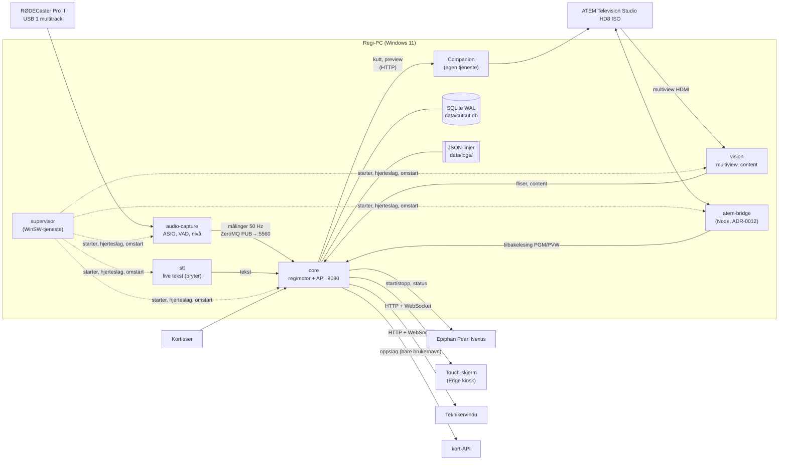
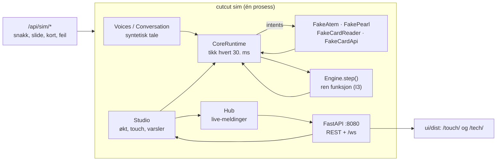
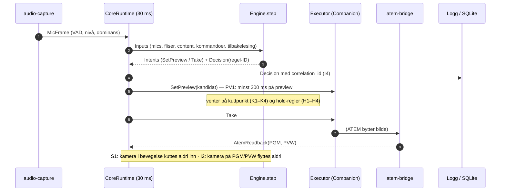
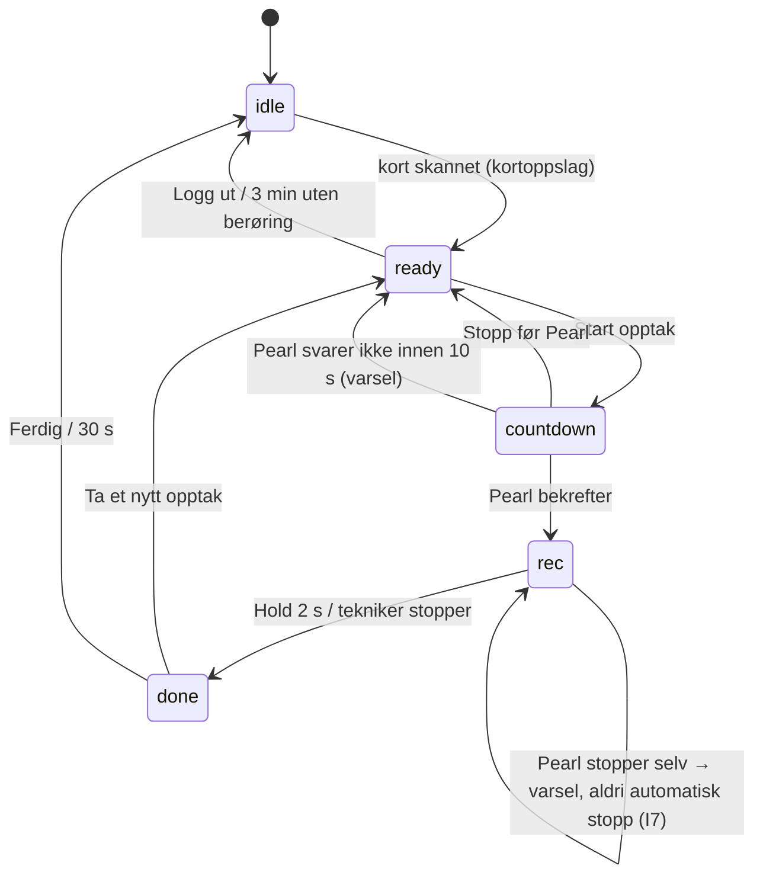
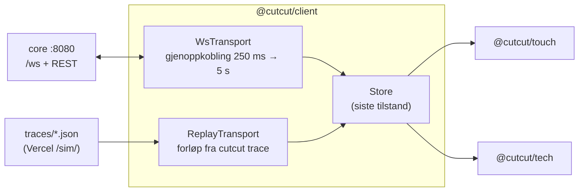

# Arkitektur

Status: M1 (simulator). Oppdateres når en prosess eller dataflyt endres. Tegningene er Mermaid og vises direkte på GitHub.

Kildene er spesifikasjonen (seksjon 3, 10 og 12), ADR-0001–0014 og planene i `docs/plans/`. Regel-ID-ene står i `docs/reference/rules.md`.

## 1. Prosesser i studio (mål for M2–M3)

Alt kjører på én Windows-PC (ADR-0001). Sendingen går gjennom ATEM og Pearl og er aldri avhengig av CutCut (I1): stopper CutCut, står siste bilde, og opptaket fortsetter.

| Prosess | Ansvar | Kan feile uten at grunnmodus stopper? |
| --- | --- | --- |
| `core` | Regimotor, økt, API, lagring, varsler | Nei – men sendingen går videre (I1), og `core` er tilbake innen 5 s med samme økt |
| `audio-capture` | Leser mic-ene, sender målinger (ikke lyd) (ADR-0014, PL-02) | Nei – uten lyd går motoren til fugleperspektiv (`S4`) |
| `vision` | Multiview: content, programbekreftelse, senere ansikt og munn | Ja |
| `stt` | Live tekst | Ja |
| `atem-bridge` | Tilbakelesing og makrosjekk mot ATEM | Ja (motoren stoler da på Companion-kvittering) |
| `supervisor` | Starter alt, ser hjerteslag, restarter med økende pause | Ja (Windows restarter den) |

## 2. Slik det kjører i M1 (`uv run cutcut sim`)

I M1 kjører alt i én prosess, med falske enheter. Det er nøyaktig den samme `Studio`-klassen og den samme motoren som i studio; bare `StudioDeps` er ulik.

## 3. Fra lyd til kutt

Motoren er en ren funksjon `step(inputs) → resultat` (PL-04). Alt med tid, I/O og enheter ligger i skallet (`CoreRuntime`). Hver beslutning logges med regel-ID og `correlation_id` (I4).

## 4. Touch-flyten

Motoren eier stegene; touch-skjermen viser dem bare. Teknikeren kan flytte touch til et hvilket som helst steg (`POST /api/touch/step`).

## 5. Hvor data ligger

| Data | Hvor | Hvor lenge | Hvorfor der |
| --- | --- | --- | --- |
| Studio-oppsett (utstyr, show, knappekart) | `site/<studio>/` (eget git-repo) | Versjonert | Lesbart, kan rulles tilbake (ADR-0006) |
| Regelverdier per forhåndsvalg | `config/defaults/rules.yaml` | Versjonert | Samme i studio, simulator og tester |
| Økter, beslutninger, revisjonslogg, varsler | SQLite WAL, `data/cutcut.db` | Økter 90 d, beslutninger 30 d, revisjon 365 d | Overlever omstart, skrives i egen tråd |
| Motorinnstillinger (AUTO, LÅS, content, skygge), tuning | SQLite `kv` | Til de endres | `core` er tilbake med samme innstillinger etter omstart |
| Logger | `data/logs/*.jsonl` | 30 d, roteres ved midnatt | Feilsøking, `correlation_id` gjennom hele kjeden |
| Hemmeligheter (PIN, nøkler) | Windows Credential Manager | – | Aldri i git, logg eller eksport |
| Kortnummer | Ingen steder | – | I8: brukes bare til oppslaget og glemmes |

## 6. Skjermene

Appene vet ikke hvilken transport de har. Det er hele forskjellen mellom studio og web-simulatoren (ADR-0013). Mister skjermen forbindelsen, vises siste tilstand gråtonet med «Kobler til igjen»; den blir aldri blank (12.5).
