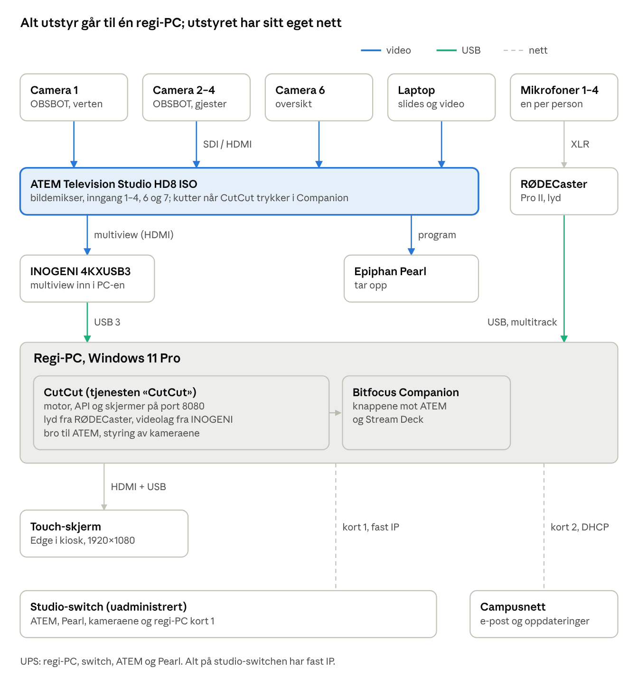

# CutCut Studio – manual

Manualen er for den som installerer, setter opp og drifter podkaststudioet, og gir det du trenger første gang. Detaljene står i resten av repoet (lenker til slutt).

<!-- pdf:skip -->
> **Slik holdes manualen oppdatert:** denne filen er kilden. PDF-en ved siden av (`CutCut-Studio-manual.pdf`) bygges med `pnpm manual`. En test feiler hvis filen er endret uten at PDF-en er bygget på nytt. Endrer du noe brukeren eller teknikeren merker, oppdaterer du manualen i samme pull request (`AGENTS.md` 8).
<!-- /pdf:skip -->

## Hva CutCut Studio er

CutCut Studio er automatisk bilderegi for podkaststudioet. Brukeren trykker Start på touch-skjermen, velger hvem som er med og tar opp. CutCut klipper mellom kameraene slik en bilderegissør ville gjort, og opptaket havner på Pearl.

Slik klipper den:

- **Lyden bestemmer.** Hver mikrofon fra RØDECaster måles hver for seg. Den som snakker, får bildet.
- **Preview først.** Neste bilde legges på preview før det tas til program, og kuttet skjer i en pause mellom setninger.
- **Kameraer på lufta står stille.** CutCut flytter aldri et kamera som er på program eller preview.
- **Mennesket vinner.** Kutter noen selv på ATEM eller Stream Deck, tilpasser CutCut seg.
- **Sendingen avhenger aldri av CutCut.** Stopper PC-en, står siste bilde, og opptaket på Pearl fortsetter. CutCut stopper aldri et opptak selv.

Det finnes to skjermer: **touch-skjermen** i studio for brukeren, og **teknikervinduet** i en nettleser for den som setter opp og følger med.

## Fysisk oppsett

Kameraene og laptopen går til ATEM, lyden går til RØDECaster, og regi-PC-en får både multiview-bildet (via INOGENI, eller rett fra ATEM over USB-C) og lyden (via USB).



CutCut klipper ved å trykke Companions knapper; Companion og ATEM snakker over studio-switchen. Pearl tar opp programmet fra ATEM. Kameraene styres over studio-switchen, og campusnettet brukes bare til trafikk ut.

## Utstyret

Alt utstyret er vanlig studioutstyr; CutCut styrer det over nett og USB fra én Windows-PC. Kamera 1 er verten, kamera 2 er gjest 1 og så videre, likt på ATEM, i CutCut og på mikrofonene.

| Utstyr | Rolle | Kobles til | Hva CutCut gjør med det |
| --- | --- | --- | --- |
| Regi-PC (i5-12500, 16 GB, RTX 4060 Ti, 250 GB SSD) | Kjører CutCut og Companion | Studio-switch (kort 1), campusnett (kort 2), UPS | Alt |
| ATEM Television Studio HD8 ISO | Bildemikser | Studio-switch; kameraene inn på SDI | Leser program, preview og multiview; kutter via Companion |
| INOGENI 4KXUSB3 (standard) | Tar multiview-bildet inn i PC-en | ATEM multiview-utgang (HDMI) → USB 3 på PC-en. Alternativ: ATEM-ens USB-C rett til PC-en (se under) | Ser kamerarutene, laptop-ruta og program |
| RØDECaster Pro II | Lydmikser med fire mikrofoner | USB til PC-en (multitrack) | Måler hvem som snakker |
| Camera 1–4: OBSBOT Tail 2 | Verten og gjest 1–3 | Studio-switch; ATEM inngang 1–4 | Presets, utsnitt, farge og AI-tracking over VISCA og OSC |
| Camera 6: oversiktskamera | Fugleperspektiv | ATEM inngang 6 | Klippes til, styres ikke |
| Laptop | Slides og video | ATEM inngang 7 | Vises når det kommer ny slide |
| Epiphan Pearl Nexus | Opptak | Studio-switch; program fra ATEM | Starter, stopper og leser status |
| Bitfocus Companion (+ Stream Deck) | Knappene mot ATEM | Kjører på regi-PC-en | CutCut trykker Companions knapper for preview og TAKE |
| Touch-skjerm | Brukerens skjerm | HDMI og USB til PC-en | Viser touch-appen i kiosk |
| Uadministrert switch | Studionettet | Alt utstyret over | – |
| UPS | Strøm | PC, switch, ATEM, Pearl | – |

Inngang 5 og 8 på ATEM brukes ikke. Kortleser (ELATEC TWN3) kommer senere.

**Anbefaling: samme kameramodell i hele studioet.** Like kameraer er mye enklere å fargematche, og presets og zoom oppfører seg likt. Teststudioet bruker OBSBOT Tail 2 på alle fire plassene. CutCut støtter også Canon CR-N300, og kan blande modeller om det trengs: modellen velges per kamera under **Utstyr og nettverk**. Et annet studio kan altså bruke Canon på alle plassene.

**Multiview inn i PC-en: INOGENI eller ATEM-ens USB-C.** I stedet for INOGENI kan ATEM-en sende multiviewen rett til PC-en over sin webkamera-utgang (USB-C): velg **Output → Webcam Out → Multi View** i ATEM Software Control, og **ATEM webkamera-utgang** under Oppsett, steg 6. Det sparer en boks og gjør multiview-utgangen ledig for en skjerm, men bildet kan være komprimert og litt mer forsinket. INOGENI er standard til begge er testet i studioperioden; CutCut tar hensyn til forsinkelsen for metoden som er valgt.

## Regi-PC: Windows og programvare

PC-en kjører vanlig Windows 11 Pro uten sentral administrasjon. CutCut-pakken har med seg alt den selv trenger (Python, Node, skjermene og modellene), så bare dette må installeres i tillegg:

| Programvare | Hvorfor | Merk |
| --- | --- | --- |
| Windows 11 Pro, 23H2 eller nyere | Operativsystem | Lokal administrator under oppsettet |
| RØDECaster ASIO-driver | Lyden fra hver mikrofon | **Ikke** RØDE Virtual Devices-driveren; de kan ikke kjøre samtidig |
| NVIDIA-driver | Skjermkortet | Brukes ikke av CutCut nå, men skal være oppdatert |
| INOGENI 4KXUSB3, eller ATEM-ens USB-C | Multiview inn | Trenger ingen driver; vises som et kamera i Windows («INOGENI» eller «Blackmagic Design») |
| Bitfocus Companion 4.x eller 5.x | Knappene mot ATEM | Samme PC. CutCut-sidene importeres (steg 7) |
| Microsoft Edge | Touch-skjermen i kiosk | Følger med Windows |
| CutCut Studio | Selve appen | Zip fra GitHub-releasen; installeres som tjenesten `CutCut` |

**Windows-innstillinger** settes av skriptet `setup-pc.ps1` som følger med pakken: strømplan (aldri hvilemodus), ingen USB-strømsparing, ingen rask oppstart, ingen skjermsparer, Windows Update utenfor åpningstiden, tidssynkronisering og brannmur for port 8080. Fast IP, BIOS og UPS sjekker det bare; de settes for hånd.

**Nettverk:**

- Kort 1 mot studio-switchen: fast IP i samme nett som ATEM, *uten* gateway.
- Kort 2 mot campusnettet: DHCP. Brukes til e-post, oppdateringer og senere kort-API.

**BIOS:** «Power on after AC loss» på, så PC-en starter selv etter strømbrudd.

**Passord** legges i Windows Credential Manager, aldri i filer: `pearl_password`, `operator_pin` og `admin_pin`.

## Installasjon steg for steg

Installasjonen tar en halv dag, og etterpå starter alt av seg selv når PC-en slås på. Gjør stegene i rekkefølge, som administrator.

1. **Strøm og nett.** PC, switch, ATEM og Pearl på UPS. Alt utstyret på studio-switchen med faste IP-adresser etter IP-planen. Kort 1 på PC-en til switchen, kort 2 til campusnettet.
2. **Kabler.** Kameraene til ATEM inngang 1–4 og 6, laptop på inngang 7. ATEMs multiview-utgang til INOGENI, og INOGENI i en USB 3-port på PC-en (ikke via hub). Med ATEM-ens webkamera-utgang i stedet: USB-C fra ATEM-en rett i en USB 3-port. RØDECaster med USB til PC-en. Touch-skjermen med HDMI og USB.
3. **Windows.** Installer drivere (RØDECaster ASIO, NVIDIA). Sett BIOS til «Power on after AC loss».
4. **CutCut-pakken.** Last ned `cutcut-<versjon>-win64.zip` og `.sha256` fra GitHub-releasen. Kopier `site\multimediesenteret` fra repoet til `C:\CutCut\site`. Kjør:

   ```powershell
   Expand-Archive .\cutcut-1.0.0-win64.zip -DestinationPath $env:TEMP\cutcut-pkg
   & "$env:TEMP\cutcut-pkg\cutcut-1.0.0\installer\install.ps1" -Zip .\cutcut-1.0.0-win64.zip
   ```

   Skriptet pakker ut, prøver versjonen og installerer Windows-tjenesten `CutCut`.
5. **Windows-oppsettet.** `C:\CutCut\current\installer\setup-pc.ps1` sjekker; med `-Fix` retter det strøm, oppdateringstider, tid og brannmur.
6. **Passord.** Legg PIN-er og Pearl-passordet i Credential Manager, for eksempel:

   ```powershell
   C:\CutCut\current\python\python.exe -m keyring set "CutCut Studio" admin_pin
   ```

   Gjenta for `operator_pin` og `pearl_password`.
7. **Kiosk på touch-skjermen.** `installer\kiosk\setup-kiosk.ps1 -Password (Read-Host -AsSecureString) -AutoLogon` lager kiosk-brukeren og starter Edge med touch-siden. Start PC-en på nytt: touch-siden skal komme opp av seg selv.
8. **Companion.** Installer Companion på PC-en, legg inn ATEM og Pearl, og importer CutCut-sidene (side 10 og 11 og variablene).
9. **Åpne teknikervinduet** på `http://127.0.0.1:8080/tech/` og logg inn med admin-PIN-en. Under **Helse → Prosesser** skal `core`, `audio-capture`, `atem-bridge` og `vision` kjøre.
10. **Gå gjennom setup-hjelperen** (neste kapittel).

Ny versjon senere: `install.ps1 -Zip <ny zip>` i servicevinduet. Svarer ikke den nye versjonen innen 120 s, går den tilbake til forrige selv.

## Første oppsett i appen

Det studiospesifikke settes opp i teknikervinduet under **Oppsett**, i ti steg. Hvert steg forklarer hva du gjør, sjekker utstyret med «Sjekk steget» og godkjennes når sjekkene er grønne. Det du legger inn, lagres på PC-en, ikke i noe repo.

| Steg | Hva du gjør | Ferdig når |
| --- | --- | --- |
| 1 Nett og IP | Skriv inn IP-adressene under **Utstyr og nettverk** | ATEM, Companion, Pearl og kameraene svarer; begge nettverkskortene er grønne |
| 2 PC og Windows | Sjekk strøm, oppdateringer og at alle prosessene kjører | Sjekkene for PC og prosesser er grønne |
| 3 ATEM | 1080p50, inngangsnavn («Fiks for meg» setter dem) | ATEM svarer og har riktig oppsett |
| 4 Kameraer | Manuell hvitbalanse og eksponering. Hold et gråkort foran hvert kamera og trykk **Start fargematching** | Kameraene er like referansekameraet |
| 5 RØDECaster | Multitrack på. Én og én snakker i hver mikrofon; CutCut måler lekkasje og støy. Lagre som fasit | Riktig kanal per mikrofon, fasit lagret |
| 6 Multiview | Velg **Multiview-capture** (INOGENI eller ATEM webkamera-utgang). **Finn rutene i bildet**, dra hjørnene om nødvendig, **Lagre rutekart** | Hver rute viser riktig kamera |
| 7 Companion | Importer CutCut-sidene | Companion svarer med «sider v1» |
| 8 Makroer og grafikk | Lag layoutmakroene 10–40 i ATEM og «Kun lyd»-grafikken | Makrosjekken er grønn |
| 9 Pearl og innlogging | Pearl-bruker og opptaker; ta et testopptak på 5 s. Innlogging: Start-knapp | Pearl er klar |
| 10 Generalprøve | Alle sitter på plass og snakker i 5 min med AUTO på | Kuttene ser riktige ut |

Til slutt: **Innstillinger → Oppsett → Lagre oppsett** gir én fil med alt du har lagt inn (uten PIN og passord). Ta vare på den; med «Hent oppsett» er en ny PC satt opp på minutter.

Under **Innstillinger** setter du også support-e-post (vises når brukeren trykker «Trenger du hjelp?»), show-type og eventuelt teknikere. Uten teknikerliste gir admin-PIN-en tilgang.

## Touch-skjermen: slik bruker du studioet

Brukeren trenger bare tre trykk: Start, Start opptak og Avslutt opptak. Resten gjør studioet selv.

1. **Velkommen.** Trykk **Start**. Den grønne prikken «Studio klart» betyr at kamera, lyd og opptak er sjekket.
2. **Hvem er med?** Velg antall personer (programleder er alltid med; gjestene har hver sin farge og mikrofon). Velg **Video og lyd** eller **Kun lyd**. Tegningen viser hvor folk skal sitte. Trykk **Start opptak**.
3. **Lydsjekk.** Nedtelling 3–2–1 mens alle sier noen ord. Mikrofonene får en hake når de er hørt.
4. **Opptak.** Skjermen viser hva som er i bildet nå og hvem som snakker. CutCut klipper selv. Ser det ut som noen sitter foran feil kamera (plassjekken), kommer et gult felt: **Vi bytter plass**, **Bytt i CutCut** (CutCut bruker det andre kameraet resten av økten) eller **Det stemmer**. **Trenger du hjelp?** varsler teknikeren og viser support-e-posten; opptaket går videre.
5. **Avslutt opptak:** hold knappen inne i 2 sekunder. Et kort trykk gjør ingenting, så ingen avslutter ved et uhell.
6. **Ferdig.** «Opptaket er lagret», med lengde. Velg **Ferdig, logg ut** eller **Ta et nytt opptak**. Brukeren logges ut av seg selv etter 30 s, eller etter 3 minutter uten trykk på valgskjermen.

Opptaket ligger på Pearl i studioet. Feil vises med én setning uten tekniske ord; små avvik ser bare teknikeren.

**Teknikertilgang fra touch:** hold inne logoen øverst til venstre i 5 sekunder.

## Teknikervinduet

Teknikervinduet åpnes i en nettleser på `http://<regi-PC>:8080/tech/`, og oversikten viser alt som skjer på én side. Operatør (operator-PIN) ser de fem første sidene; admin (admin-PIN) ser alle.

| Side | Hva du ser og gjør | Hvem |
| --- | --- | --- |
| Oversikt | Multiview (klikk på en rute for å klippe selv), hva som er på lufta og på preview, mikrofonene, de siste 60 sekundene og de siste beslutningene. **Auto på/av**, **Lås bildet** og **Bird nå** | Operatør |
| Kameraer | Bilde og status per kamera, presets (tett og vid), små justeringer og AI-tracking. Bare kameraer som ikke er på lufta kan flyttes | Operatør |
| Opptak | Pearl og økta nå, ISO-opptak i ATEM og dagens opptak | Operatør |
| Helse | Alle sjekkene (grønn, gul, rød), åpne varsler og prosessene. **Kjør alle nå**. **Feilsøkingsmodus** (admin slår av og på) | Operatør |
| Logg | Hver beslutning med regel og grunn. Filter for kutt, sikkerhet og skygge. CSV og feilsøkingspakke | Operatør |
| Regi | Tempo (Rolig, Standard, Energisk), finjustering og bryterne (av, skygge, på) | Admin |
| Oppsett | Setup-hjelperen, adresser, rutekart, mikrofonfasit og fargematching | Admin |
| Innstillinger | Innlogging, show-type, teknikere, varsling og support-e-post, lagre og hente oppsett | Admin |

Alt kan også styres fra Stream Deck via Companion (side 10 og 11), og det CutCut gjør, vises likt alle steder.

## Funksjonene

Grunnmodus klipper på lyden og er alltid på; alt annet er brytere som slås på én og én under **Regi**.

**Grunnmodus (alltid på):**

- **Taleren i bildet:** den som snakker, får nærbildet etter en kort bekreftelsestid, og kuttet kommer i en pause.
- **Fugleperspektiv:** åpning av opptaket, krysstale, latter og lange pauser viser oversiktsbildet.
- **Lekkasje:** en stemme som høres i en annen mikrofon, gir ikke kutt til feil person. En mikrofon som er dempet på RØDECaster, klippes ikke til.
- **Laptop som content:** ny slide vises; video på laptopen holdes i bildet.
- **Sikkerhet:** aldri kutt til et kamera som beveger seg; uten lyd går bildet til fugleperspektiv og AUTO venter til lyden er tilbake.
- **Kun lyd:** ingen kameraer, «Kun lyd»-grafikken på program.
- **Grafikk på lufta:** setter teknikeren svart, fargebarer eller en logo på program, venter AUTO til et kamera er tilbake, og fortsetter 5 s etter. Oversikt viser «AUTO venter». Ligger studioet på en logo mellom øktene, tar CutCut over når opptaket starter.
- **Uten ATEM:** kan ATEM-en ikke leses på 2 s, trykker CutCut ikke TAKE, fordi det ville vært i blinde.
- **Tempo:** Rolig, Standard eller Energisk endrer hvor fort og hvor ofte det klippes.

**Bryterne** har tre stillinger: **Av**, **Skygge** (reglene kjører og logges, men klipper ikke; se Logg → Skygge) og **På**. Prøv alltid en bryter i skygge før den slås på. En bryter som feiler, går selv tilbake til skygge og varsler gult.

| Bryter | Hva den gjør | Krever |
| --- | --- | --- |
| Layouter (PiP og quad) | Bilde-i-bilde med laptop, eller firedelt når mange snakker | Makroene 10–40 i ATEM |
| Vekslende utsnitt | Kameraer av lufta veksler mellom tett og vid | Presets tett og vid per kamera |
| Langsom zoom | Zoomer sakte inn på en taler som snakker lenge | Kamera som tåler sakte zoom |
| AI-tracking | OBSBOT følger personen selv; CutCut flytter det ikke da | OBSBOT Tail 2 |
| Plassjekk | De første 2 minuttene: sitter hver person foran sitt kamera? Sammenligner hvem som snakker med hvilket bilde som viser en munn som beveger seg. I skygge (standard) logges det bare | Ansikt og munn i videolaget |
| Videolag bekrefter | Munnbevegelse i bildet bekrefter hvem som snakker, og avslører lekkasje | Videolaget med ansikt og munn |
| Reaksjonsklipp | Viser en lytter som smiler eller nikker, i talerens pause | Videolag bekrefter |

**Andre funksjoner:**

- **Fargematching** (Oppsett, steg 4): like farger på alle kameraene med et gråkort.
- **ISO-opptak** i ATEM som reserve, fra Opptak eller sammen med Pearl.
- **Morgensjekk** kl. 07:00 og ved oppstart; resultatet vises som en prikk på touch.
- **Nattlig vedlikehold:** rydding og kopi av databasen.
- **Feilsøkingsmodus** (Helse, admin): i 1, 8 eller 24 timer tas alt som kommer inn til motoren opp, med beslutningene og hvor lang tid hvert kutt tok. Slår seg av selv. Brukes i studioperioden og når noe skal feilsøkes.

Kommer senere: innlogging med adgangskort, e-postvarsling og publisering til Panopto.

## Daglig drift

Studioet passer på seg selv; teknikeren trenger bare å se på Helse når prikken på touch-skjermen er gul.

- **Morgensjekk:** hver morgen kl. 07:00 og ved hver oppstart kjøres alle sjekkene. Resultatet vises som en liten prikk på touch-skjermens velkomstside: grønn, eller gul når teknikeren har noe å se på. Brukeren ser aldri detaljene.
- **Før et viktig opptak:** åpne teknikervinduet, se at Helse er grønn og at alle kameraene har bilde under Oversikt.
- **Under opptak:** følg med under Oversikt. Klikk på en rute i multiview for å klippe selv; **Auto på** tar CutCut tilbake. **Lås bildet** holder bildet som det er.
- **Når brukeren trykker «Trenger du hjelp?»**, kommer et varsel i teknikervinduet. Opptaket går videre.
- **Om natten** (kl. 03–05, aldri under en økt) rydder CutCut gamle data og tar en kopi av databasen.

| Data | Tas vare på i |
| --- | --- |
| Beslutningslogg | 30 dager |
| Logger | 30 dager |
| Økthistorikk og varsler | 90 dager |
| Kopi av databasen | De 7 siste nætter |
| Kopi av oppsettet | De 20 siste endringene |

Opptakene ligger på Pearl (og ATEM-disken ved ISO). CutCut sletter aldri opptak.

## Vedlikehold og oppdatering

Oppdateringer gjøres i servicevinduet, aldri under opptak, og en ny versjon som ikke virker, rulles tilbake av seg selv.

1. Last ned ny zip og `.sha256` fra GitHub-releasen.
2. Kjør `C:\CutCut\current\installer\install.ps1 -Zip <ny zip>`.
3. Skriptet installerer ved siden av den gamle, bytter og venter til den nye svarer. Ellers går den tilbake innen 120 s. De tre nyeste versjonene beholdes.
4. Sjekk Helse etterpå.

**Windows Update** er satt til å kjøre utenfor åpningstiden (06–23). Ikke oppdater drivere midt i et semester uten å kjøre setup-hjelperen på nytt.

**Ta vare på oppsettet:** Innstillinger → Oppsett → **Lagre oppsett** etter hver endring. Filen har adresser, teknikere, varsling, rutekart og mikrofonfasit, men ingen PIN eller passord.

**Tilbake til en kopi av databasen:** `Stop-Service CutCut`, kopier filen fra `C:\CutCut\data\backup\` til `C:\CutCut\data\cutcut.db`, `Start-Service CutCut`.

## Tilgang, sikkerhet og personvern

CutCut kjører helt lokalt på regi-PC-en; ingen skytjeneste er med når det klippes.

| Hvem | Hvordan | Kan |
| --- | --- | --- |
| Brukeren | Touch-skjermen, Start | Ta opp, få hjelp, logge ut |
| Operatør | Teknikervinduet med operator-PIN | Følge med, klippe selv, AUTO og LÅS, starte og stoppe opptak |
| Admin | Teknikervinduet med admin-PIN | I tillegg regler, brytere, oppsett og innstillinger |

- PIN-er og passord ligger i Windows Credential Manager, aldri i filer, logg eller eksport.
- Ekte IP-adresser og teknikerliste ligger bare på studio-PC-en.
- Kortnummer lagres og logges aldri (når kortinnlogging kommer).
- CutCut stopper aldri et opptak av seg selv, og flytter aldri et kamera som er på lufta.
- Feilsøkingspakken har ingen passord, personlister eller kortnummer.

## Når noe går galt

Sendingen og opptaket går videre selv om CutCut har problemer; start alltid under **Helse** i teknikervinduet, som sier hva som er galt.

| Det du merker | Sjekk | Gjør |
| --- | --- | --- |
| Ingen lyd, bildet står på fugleperspektiv | `H-AUD-1` | RØDECaster på og i multitrack; USB-kabelen i. AUTO fortsetter selv når lyden er tilbake |
| CutCut klipper ikke | `H-ATEM-1`, `H-COMP-1` | Sjekk IP under Oppsett → Utstyr og nettverk, og at Companion kjører. CutCut kutter direkte i ATEM når Companion er nede |
| Opptaket startet ikke | `H-PRL-1` | Pearl på nett og ledig plass. Start fra Pearl-menyen om det haster |
| Kamera beveger seg ikke, eller har flyttet seg | `H-CAM-*`, `H-CAM-MOVE` | Strøm og nett til kameraet; manuell modus; hent preset |
| Touch-skjermen er svart | `H-PROC-touch` | Vent 30 s: Edge startes på nytt av seg selv |
| Ingen kamerabilder i teknikervinduet | `H-VID-1` | INOGENI (eller ATEM-ens USB-C) i en USB 3-port; riktig metode valgt i steg 6; ingen andre programmer har enheten åpen |
| Etter strømbrudd | – | PC-en starter selv. Sjekk at Helse er grønn før neste opptak |

**Feilsøkingsmodus:** skjer noe som er vanskelig å forklare, slå på feilsøkingsmodus under Helse (for eksempel 8 timer) og prøv igjen. Alt motoren fikk inn og bestemte, tas da opp.

**Feilsøkingspakke:** Logg → «Feilsøkingspakke» (admin). Den har ingen passord, tar med siste time av feilsøkingsopptaket og kan sendes til support.

**Mer informasjon i repoet** ([github.com/multimediesenteret/CutCutStudio](https://github.com/multimediesenteret/CutCutStudio)):

- `docs/runbooks/`: steg for steg for feilene over.
- `docs/studio/tjenester.md`: installasjon og oppdatering.
- `docs/setup/README.md`: setup-hjelperens steg i detalj.
- `docs/studio/maskintest.md` og `docs/studio/testdag.md`: maskintestene og sjekklista for studioperioden.
- `docs/STATUS.md`: hvor prosjektet står.
- Simulatoren: [cutcutstudio2026.vercel.app](https://cutcutstudio2026.vercel.app) viser begge skjermene uten utstyr.

## Adresser, porter og mapper

Alt CutCut bruker, ligger på regi-PC-en under `C:\CutCut`, og skjermene nås på port 8080.

| Hva | Hvor |
| --- | --- |
| Teknikervinduet | `http://<regi-PC>:8080/tech/` |
| Touch-skjermen | `http://127.0.0.1:8080/touch/` (åpnes av kiosken) |
| Status for overvåkning, uten innlogging | `http://<regi-PC>:8080/api/health` |
| Companion | `http://127.0.0.1:8000` |
| ATEM | UDP 9910 |
| Kameraene | VISCA over UDP 52381; OBSBOT også OSC |
| Pearl | HTTPS 443 |
| Programmet | `C:\CutCut\current` (lenke til `versions\<versjon>`) |
| Studio-oppsettet (utgangspunkt) | `C:\CutCut\site` |
| Database, logger, kopier | `C:\CutCut\data` (`logs`, `backup`, `oppsett`, `hwtest`, `debug`) |

## Ordliste

| Ord | Betyr |
| --- | --- |
| Program | Bildet som tas opp og sendes |
| Preview | Neste bilde, klart til å tas til program |
| TAKE | Bytter preview til program |
| Multiview | ATEMs oversikt over alle kildene i ett bilde; CutCut leser det gjennom INOGENI eller ATEM-ens USB-C |
| Rutekart | Hvor hver kamerarute ligger i multiview-bildet |
| Fugleperspektiv (Bird) | Oversiktsbildet fra Camera 6 |
| Content | Laptopen (slides og video) |
| Preset | Lagret kameraposisjon, for eksempel «tett» og «vid» |
| AUTO | CutCut klipper selv. Av: bare mennesket klipper |
| LÅS | Bildet holdes som det er |
| Skygge | En bryter som kjører og logger, men ikke klipper |
| Lekkasje | En stemme som også høres i en annen persons mikrofon |
| ISO-opptak | ATEM tar opp hver inngang for seg, som reserve |
| Kun lyd | Opptak uten kameraer, med en egen grafikk på program |
