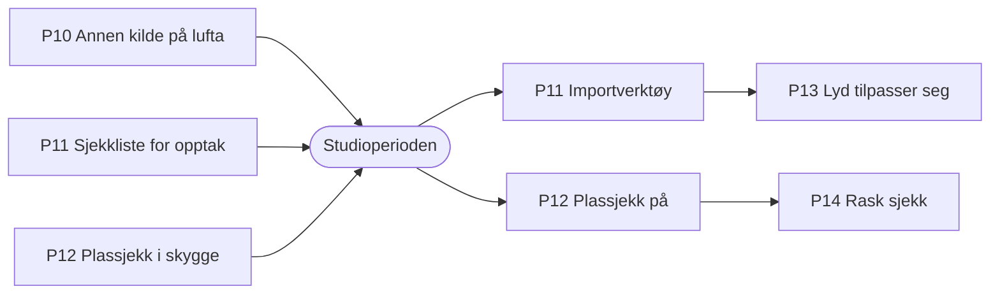

# Plan: P10–P14, forbedringer etter gjennomgang 2026-10-24

Status: godkjent 2026-10-24 (D-072): bygges i denne rekkefølgen, med svarene på Q43–Q45 under · Dato: 2026-10-24 · Av: agent (Claude) for Multimediesenteret · Bygger på `for-studio.md` (P1–P9)

Fem forbedringer kom ut av en gjennomgang av hva lignende løsninger gjør. Hver er sjekket mot koden. Planen sier hva som er galt eller mangler i dag, hvilken løsning som er best, og i hvilken rekkefølge de bør bygges.

## 1. Kort fortalt

| # | Pakke | Hvorfor | Når | Størrelse |
| --- | --- | --- | --- | --- |
| P10 | Annen kilde på lufta | **Feil i dag:** CutCut kan klippe vekk fra en logo, svart eller mediaspiller som teknikeren har satt på program, og Helse viser da rødt «ATEM svarer ikke» | Før studioperioden | Liten, 1 PR |
| P11 | Opptak til justering | Studioperioden må gi lydspor og logg vi kan justere reglene etter (Q1, SIM-8, P13). Uten dem er perioden brukt bare én gang | Sjekklista før perioden; verktøyet etter | Liten |
| P12 | Plassjekk | Sitter en gjest foran feil kamera, klipper CutCut trygt til feil person hele økten, og ingen tekniker ser det | Bygges i skygge før perioden; slås på etter | Middels |
| P13 | Lyd som tilpasser seg økten | Lekkasjen måles én gang i oppsettet, men nye folk flytter mikrofonene hver gang | Etter perioden, med opptakene fra P11 | Middels |
| P14 | Rask sjekk før økt | Ett trykk som kjører de sjekkene som finnes, pluss P12, på to minutter | Etter P12 | Liten |

**Rekkefølgen:** P10 først fordi det er en feil som kan vises i studioperioden. P11 fordi perioden bare kan brukes én gang, og opptakene må tas da. P12 bygges i skygge før perioden, slik at perioden gir fasit å måle den mot. P13 trenger opptakene fra P11 for å bli riktig, så den kommer etter. P14 er mest sammensetning av det som finnes, og bruker P12.

## 2. P10 Annen kilde på lufta

**I dag (sjekket i koden):**

- `AtemBridge.readback()` (`devices/atem/bridge.py`) gir `None` når program er en kilde CutCut ikke kjenner: svart, fargebarer, fargegenerator, mediaspiller 2. `None` betyr ellers «ATEM kan ikke leses».
- Derfor går `H-ATEM-1` rød med «ATEM svarer ikke. CutCut kan ikke klippe», også på touch-skjermen, selv om ATEM-en svarer fint.
- Motoren stopper ikke av `atem is None`; bare `_reconcile` hopper over. Den fortsetter å sette preview og trykke TAKE, og TAKE tar da vekk grafikken. Docstringen «core then makes no cuts» stemmer ikke.
- Mediaspiller 1 tolkes alltid som «Kun lyd»-grafikken. Legger teknikeren en logo der i en vanlig økt, regnes det som en manuell endring: AUTO venter `manual_quiet_s` (5 s) og klipper så vekk fra logoen.

**Løsning:**

1. Skill «kan ikke leses» fra «noe annet er på lufta». Ny kilde `SourceId.OTHER` med ATEM-ens inngangsnummer. `readback()` gir `None` bare når broen er nede eller tilstanden er gammel (`STALE_S`).
2. I motoren: med `OTHER` på program, eller mediaspiller 1 utenfor «Kun lyd», er AUTO **på vent for grafikk**. Ingen TAKE, ingen direkte kutt og ingen nye preview-valg; et kort hull i ATEM-avlesningen avslutter ikke ventetiden. Når et kjent kamera er tilbake på program, regnes det som en manuell endring, som i dag.
3. Mediaspiller 1 er «Kun lyd» bare når økten er «Kun lyd» (modus `A`); ellers er den grafikk.
4. `H-ATEM-1` er grønn med «annen kilde på lufta: Svart», og Oversikt viser «AUTO venter: grafikk på lufta».
5. Ingen egen innstilling: grafikk på lufta respekteres alltid (D-072). Ligger studioet på en logo mellom øktene, tar åpningskuttet (B1) over når opptaket starter.

**Q45 (besvart, D-072):** motoren trykker ikke TAKE når ATEM-en ikke har kunnet leses på 2 s, fordi det ville vært i blinde («ATEM er sannheten», ADR-0004). Regelen gjelder der det finnes en ATEM å lese (studio og live-simulator), ikke i regeltestene.

**Tester:** regeltester for ventetid og retur; test av broen med svart, barer og MP1/MP2; scenario i simulatoren («grafikk på lufta»); e2e på Oversikt. Grunnmodus gir samme kutt som før når bare kjente kilder er på lufta.

**I studio (testdag):** sett svart, så MP1, så MP2 på program under en økt. AUTO skal vente og Helse være grønn. Kamera tilbake: AUTO fortsetter etter 5 s.

## 3. P11 Opptak til justering

**Mål:** lydspor per mikrofon, bilde og logg fra studioperioden, satt sammen slik at simulatoren kan spille dem av (SIM-8) og P13 kan justeres mot dem.

**Beste løsning: ikke bygg en opptaker i CutCut.** Utstyret gjør det allerede:

| Hva | Tas opp av | Hvorfor slik |
| --- | --- | --- |
| Lyd per mikrofon | RØDECaster Pro II, multitrack-opptak til eget kort eller USB-disk | CutCut bruker ASIO-strømmen selv; et opptak i RØDECaster-en konkurrerer ikke med den og gir 48 kHz, 24 bit |
| Kamera og program | ATEM ISO (finnes, DA-8) | Hver inngang for seg, pluss DaVinci-prosjekt |
| Multiview | Opptaker på ATEM-ens USB-C-utgang (D-071) eller gjennomgangen på INOGENI, mens INOGENI går til CutCut | Videolaget trenger multiview-bildet for å spilles av |
| Målinger og beslutninger | Feilsøkingsmodus (finnes) | Hver lydmåling hvert 10. ms, hvert kutt med grunn |

**Bygget (D-072):** `cutcut opptak importer` (`src/cutcut/recordings/`). Det finner tidsforskjellen mellom hver WAV-fil og loggen ved å sammenligne lydnivået (100 Hz) med `level_db` i feilsøkingsopptaket, uten klapp. Klappet i `docs/intake/opptak-og-klippeliste.md` brukes som kontroll. Resultatet er en avspillingspakke: WAV per mikrofon, målinger, kutt og `meta.yaml`. Videoen (ISO og multiview) legges i samme mappe for hånd, og klappet synkroniserer den.

**Før perioden:** sjekklista får et punkt per opptaksøkt: RØDECaster multitrack på, ISO på, feilsøkingsmodus på, multiview-opptak på, samtykke fra alle.

**Personvern (Q43, besvart i D-072):** stemmer er personopplysninger. Bare deltakere som har skrevet under på samtykke. Opptakene ligger på en intern disk, aldri i git. De slettes når justeringen er ferdig, senest etter 12 måneder.

**Må sjekkes på RØDECaster-en:** at multitrack-opptak til kort går samtidig med USB-multitrack til PC-en, og om sporene er før eller etter fader.

## 4. P12 Plassjekk

**Bygget (D-072):** `src/cutcut/app/seatcheck.py`, bryteren `seat_check` (skygge som standard), `POST /api/seat-check`. Den melder så snart én person tydelig sitter feil, ellers når alle har snakket eller etter 2 min.

**Før:** mikrofon og kamera er bundet fast per plass (mikrofon 2 hører til kamera 2). Nedtellingen sjekker at hver mikrofon høres, men ikke at personen sitter foran riktig kamera.

**Løsning:** sammenligne hvem som snakker med hvilket bilde som viser en munn som beveger seg. Alt finnes: `mouth` og `face_ok` per kamerarute fra videolaget (P6) og `active` og `leak` per mikrofon.

1. **Når:** under nedtellingen og de første 2 minuttene av opptaket. Bare når én person snakker alene (T1 aktiv, ikke lekkasje, de andre stille), fordi det gir rene målinger.
2. **Hva:** for hver person en tabell over kameraene: hvor stor del av personens taletid munnen beveget seg i hvert bilde.
3. **Når det varsles:** etter minst 15 s tale alene. Varsel hvis et annet kamera har minst 50 % og minst 25 prosentpoeng mer enn riktig kamera. To personer som peker på hverandres kamera, er et bytte. Et riktig kamera uten ansikt i over 80 % av tiden er en tom plass.
4. **Hvor:** en egen, ren klasse i appen (`app/seatcheck.py`), ikke i motoren, fordi den ikke endrer kutt. Testes med syntetiske målinger.
5. **Hva brukeren ser:** setekartet på touch markerer plassen, med «Gjest 1 ser ut til å sitte ved kamera 3». To valg: **Vi bytter plass** (sjekken går på nytt) eller **Bytt i CutCut** (bare denne økten bruker kamera 3 for gjest 1). Teknikeren får det samme som et gult varsel.
6. **Skygge først:** før perioden bare logget (`seat_check` i loggen og feilsøkingsopptaket). I perioden settes noen bevisst feil, så vi ser at den treffer, og hvor fort.

**Q44 (besvart, D-072):** «Bytt i CutCut» er lov under opptak, fordi feil person i bildet hele økten er verre enn ett kutt i overgangen.

**Uten videolag** (kun lyd, eller videolaget nede) hoppes sjekken over i stillhet; Helse viser alt at videolaget mangler.

## 5. P13 Lyd som tilpasser seg økten

**Bygget (D-072):** `AdaptiveLeak` i `audio/leak.py`, bryteren `audio_adapt` (skygge som standard), «Denne økten» i setup-steg 5. Del 2 (nivå per person) måles og vises, men brukes ikke i kutt før opptakene fra P11 viser at det hjelper. En person regnes som alene når mikrofonen er minst 10 dB over alle andre.

**Før:** `LeakDetector` (`audio/leak.py`) brukte lekkasjematrisen fra setup-steg 5, med 6 dB margin, hele semesteret. Dominans er eget nivå minus det høyeste av de andre.

**Løsning, i to deler:**

1. **Lekkasje oppdateres i økten.** Mens én person snakker alene (minst 10 dB over alle andre mikrofoner), måles lekkasjen fra den mikrofonen til de andre og glattes over rundt 30 s tale. Verdien holdes innenfor ±6 dB fra fasiten, så en feilmåling aldri kan gjøre mye skade. Den nullstilles ved hver ny økt, fordi folk og mikrofoner er nye.
2. **Nivå per person.** En løpende median av hver persons talenivå i økten. En stille gjest får like stor sjanse som en høylytt når begge snakker. Hvor mye det skal veie, avgjøres med opptakene fra P11.

**Hvor:** i `audio-capture`, som gir både `leak` (fasit) og `leak_adapt` (tilpasset) på bussen. Ny bryter `audio_adapt` med av, skygge og på, sendt med `audio.config` som i dag.

**Prøves med opptakene fra P11:** spill av hver økt med og uten tilpasning, og sammenlign med klippelista (Q2) og akseptansetallene (10.4). Slås på bare hvis den gir minst like gode tall.

**I teknikervinduet:** Helse → Lyd viser fasit og tilpasset matrise side om side, med en knapp for å nullstille.

## 6. P14 Rask sjekk før økt

**I dag finnes:** morgensjekken kl. 07 (HS-4), mic-sjekken i setup-steg 5, lydsjekken i nedtellingen (AU-7), multiview-sjekken («Sjekk nå») og fargematching (steg 4).

**Løsning:** knappen **Sjekk dagens oppsett** i teknikervinduet. Den kjører det som finnes i én rekke, på rundt 2 minutter:

1. Helse: alt grønt eller forklart.
2. Multiview mot rutekartet.
3. Hver person sier navnet sitt: mikrofon, nivå og plass (P12) på én gang.
4. Farge: hvert kamera mot fasiten, uten å justere.

Resultatet er én rapport med grønt, gult og rødt, lagret i loggen. Ingen nye regler; bare sammensetning. Et valg i Innstillinger kan kreve sjekken før første økt hver dag.

## 7. Krav som gjelder alle

- Grunnmodus gir samme kutt som før når ingenting av dette slår inn (10.4).
- Ingen pakke stopper et opptak (I7) eller flytter et kamera på lufta (I2).
- Alt nytt som påvirker kutt, starter i skygge og har en bryter.
- Manualen, `testdag.md` og `STATUS.md` oppdateres i samme PR som koden (AGENTS.md 8).

## 8. Spørsmål

Q43–Q45 er besvart i D-072 (se over).
