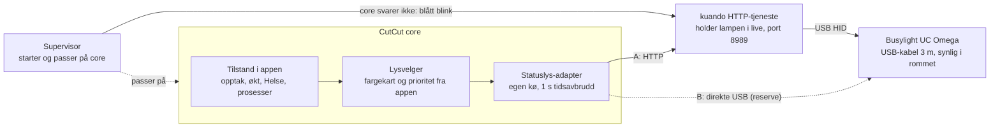

# Research: statuslys med Kuando Busylight UC Omega

Dato: 2026-10-23 · Status: forslag, ikke bygget. Venter på test med én lampe (Q42) · Arbeidsdokument: Claude Docs, «Kuando Busylight UC Omega – evaluering og forslag til integrasjon i CutCut Studio»

## Kort fortalt

Anbefalingen er å støtte Busylight UC Omega gjennom **kuando HTTP som Windows-tjeneste** på regi-PC-en. CutCut sender korte HTTP-kall til `localhost:8989` når studioet skifter tilstand, slik vi alt snakker med Companion og Pearl. Lampen blir et rent statuslys: den kan aldri stoppe eller forsinke et opptak, og den spiller aldri lyd.

- **Standardfarger:** rød under opptak, grønn når studioet er klart, blå ved feil. Hvilken tilstand som gir hvilken farge, settes i appen under Innstillinger.
- **Reserve:** CutCut kan styre lampen direkte over USB (HID) uten Kuando-programvare. Det er bare aktuelt hvis tjenesten skaper problemer i testen.
- **Ikke anbefalt:** kuandoHUB, WebHID og Chrome-appen passer ikke for en tjeneste som går døgnet rundt.

To ting må avklares med en lampe i hånden før vi bygger: om lampen slukker når CutCut stopper, og om tjenesten holder lyset oppe av seg selv (se testplanen).

## Lampen

[Busylight UC Omega](https://busylight.com/products/busylight-uc-omega/) er en liten RGB-lampe som er synlig fra alle kanter. Den kobles til med USB og krever ingen driver, fordi Windows ser den som en HID-enhet.

| Egenskap | Det vi vet | Kilde |
| --- | --- | --- |
| Lys | Alle farger (RGB, 0–100 per kanal), synlig 360° | Produktsiden, HTTP-manualen |
| Mønstre | Fast farge, blink (av/på i steg på 0,1 s), puls, farge med korte blink i en annen farge | HTTP-manualen 1.0.8 |
| Lyd | 8 ringetoner, volum 0, 25, 50, 75 og 100 % | Produktsiden, HTTP-manualen |
| Tilkobling | USB, kabel 3 m, magnetfeste | Produktsiden |
| USB-ID | Leverandør `0x27BB`. Omega er `0x3BCD` eller `0x3BCF` («Omega Model 2»), UC `0x3BCB` | WebHID-SDK 1.0.2 |
| Hold i live | SDK-ene sender en hold-i-live-melding hvert 10. sekund. Hva lampen gjør uten den, står ikke i materialet og testes | WebHID-SDK 1.0.2 |

Det siste punktet er viktig: lampen ser ut til å trenge jevnlige meldinger for å holde fargen. Et program på PC-en må holde den i live hele tiden, og det programmet er enten Kuandos egen tjeneste eller CutCut.

## De fem måtene fra produsenten

Produsenten sendte fem pakker. Bare én av dem passer godt for en tjeneste som går døgnet rundt på en regi-PC: kuando HTTP som Windows-tjeneste.

| Måte | Hva den er | Kjører som | Passer for CutCut? |
| --- | --- | --- | --- |
| **kuando HTTP, tjeneste** (1.0.15, aug. 2025) | HTTP-server på `localhost:8989` med GET og POST: lys, blink, puls, farge med blink, varsel med lyd, av, liste over lamper, «about» | Windows-tjeneste, uten innlogget bruker | **Ja, anbefalt.** Samme mønster som Companion og Pearl. Installeres stille med `msiexec /q` |
| kuando HTTP, skrivebord | Samme HTTP-server som et program i systemstølfeltet | Brukerprosess | Bare hvis tjenesten ikke virker. Avhenger av at kiosk-brukeren er logget inn |
| kuandoHUB 2.1.5 | Fullt kontrollpanel: Teams, Outlook, hurtigtaster, timer og prioriteringer mellom kilder. HTTP er innebygd, og WebSocket kom i 1.1.14 | Brukerprosess med vindu | **Nei.** Prioriteringene kan overstyre CutCut. «Auto-Away» gjør lampen gul når PC-en låses. Kan ikke kjøres samtidig med kuando HTTP |
| JavaScript, WebHID 1.0.2 | SDK som styrer lampen fra en nettside i Chrome eller Edge | Nettleserfane som må være åpen | **Nei.** Lyset ville avhenge av at en fane er åpen, at noen har godkjent USB-tilgang, og at nettleseren ikke bremser hold-i-live-tidtakeren |
| Chrome-app 1.0 (april 2019) | Eldre Chrome-app med samme SDK | Chrome-app | **Nei.** Google har avviklet Chrome-apper |

Pakkene viser også protokollen på USB-nivå: en rapport på 64 byte med fargesteg, lyd-byte og sjekksum, og hold-i-live hvert 10. sekund. Det gjør en sjette måte mulig: at CutCut snakker med lampen direkte, for eksempel med Python-biblioteket [busylight-for-humans](https://pypi.org/project/busylight-for-humans) (Apache-2.0, støtter Omega). Den måten er reserven i neste avsnitt.

### Det viktigste fra HTTP-API-et

| Kall (GET) | Hva det gjør |
| --- | --- |
| `?action=light&red=0&green=100&blue=0` | Fast farge, 0–100 per kanal |
| `?action=blink&red=100&ontime=5&offtime=5` | Blink, tider i steg på 0,1 s |
| `?action=pulse&blue=100` | Puls |
| `?action=colorwithflash&red=100&flashblue=100` | Fast farge med korte blink i en annen |
| `?action=alert&...&sound=5&volume=25` | Farge med lyd (brukes ikke i studio) |
| `?action=off` | Av |
| `?action=busylightdevices` | Lamper som er koblet til: modell, USB-ID, `HIDDevicePath` |
| `?action=about` | Navn, versjon og evner |

Svar: 200 OK, 404 når ingen lampe er koblet til, 401 ved feil nøkkel. Flere lamper styres hver for seg med `deviceindex=0, 1, …` eller `path=<HIDDevicePath>`. Adressen settes bare i registeret (`HKLM\Software\Busylight`, `http_uri`, standard `http://localhost:8989/`); `http_token` trengs bare for kall fra andre maskiner. POST tar det samme som JSON (`action`, `sender`, `eventtype`, `eventname`, `parameter`).

## Anbefalt vei: HTTP-tjenesten, med direkte USB som reserve

HTTP-tjenesten vinner fordi produsenten støtter den og CutCut slipper å eie USB-protokollen. Direkte USB har én reell fordel: lampen slukker av seg selv hvis CutCut stopper.

| | A: kuando HTTP-tjeneste (anbefalt) | B: direkte USB fra CutCut (reserve) |
| --- | --- | --- |
| Hvem holder lampen i live | Kuandos tjeneste | CutCut selv, hvert 10. sekund |
| Hvis CutCut stopper | Lampen viser siste farge til noen endrer den. **Kan vise grønt eller rødt feilaktig** (må håndteres, se under) | Hold-i-live stopper, og lampen slukker. Feil vises av seg selv |
| Programvare på PC-en | En MSI til, med i `setup-pc.ps1` og `versions.yaml` | Ingen. Et Python-bibliotek (Apache-2.0) eller egen kode på rundt 100 linjer |
| Støtte | Produsenten | Fellesskapet. Windows er «untested» i biblioteket |
| Ny lampemodell | Tjenesten oppdateres av Kuando | Vi må legge inn nye USB-ID-er |
| Kode i CutCut | En liten HTTP-klient, som for Companion og Pearl | USB-tilgang, hold-i-live-tråd og protokoll |
| Flere lamper | `deviceindex` eller `path` per kall | Egen håndtering |
| Lisens | Kuando-programvare (lukket), installert ved siden av, ikke en avhengighet i koden | Apache-2.0, innenfor regelen i AGENTS.md |

**Slik løses ulempen med A:** supervisoren passer allerede på `core`. Svarer ikke `core` på 10 sekunder, setter supervisoren lampen til blått blink. Når tjenesten stoppes, slås lampen av. Da viser lampen aldri «klart» eller «opptak» fra et CutCut som ikke lever.

Velger vi B senere, er det bare adapteren som byttes. Innstillingene, fargekartet og helsesjekken er de samme.

## Statuser og triggere

Lampen viser alltid den viktigste tilstanden som gjelder akkurat nå. Opptak slår alt annet, slik at ingen går inn i et rom som tar opp. Lista under er forslaget til standard, i prioritert rekkefølge.

| # | Trigger (tilstand i CutCut) | Standardlys | Hvorfor |
| --- | --- | --- | --- |
| 1 | CutCut svarer ikke (meldes av supervisoren) | Blått blink | Lampen skal aldri vise noe CutCut ikke vet. Pearl kan fortsatt ta opp, så blått blink betyr «ukjent: sjekk før du går inn» |
| 2 | Opptak pågår, og Helse er rød | Rødt med korte blå blink | Rødt holder folk ute; det blå forteller teknikeren at noe er galt |
| 3 | Opptak pågår (Pearl tar opp, også «Kun lyd») | Rødt, fast | Vanlig «på lufta» |
| 4 | Opptak starter (Start opptak er trykket, Pearl har ikke bekreftet) | Rødt blink | Folk i rommet ser at det er i ferd med å starte |
| 5 | Feil uten opptak (Helse rød) | Blått, fast | Eierens ønske |
| 6 | Advarsel (Helse gul) | Gult, fast | Kan brukes, men studioet virker |
| 7 | Økt i gang, ikke opptak (noen har trykket Start) | Grønt, fast | Klart til opptak |
| 8 | Studio klart, ingen økt | Grønt, svakt (30 %) | Ledig og klart |
| 9 | Studio stengt eller natt (valgfritt tidsvindu) | Av | Sparer lampen og forstyrrer ingen |

Tilstander som kan legges til i appen: feilsøkingsmodus, LÅS eller AUTO av (teknikeren styrer selv), ISO-opptak på ATEM-en, og nedtelling før en økt slutter.

**I appen** får Innstillinger en side «Statuslys» (admin):

- Av eller på, og hvilken metode (HTTP-tjeneste eller direkte USB).
- Én rad per trigger: på eller av, farge (fargevelger eller fast palett), mønster (fast, blink, puls, farge med blink) og styrke i prosent. Rekkefølgen er prioriteten, og den kan dras.
- Knappen **Test lampen** viser fargene etter tur. Den er sperret under opptak.
- Et lite bilde av lampen på Oversikt og i simulatoren, slik at teknikeren ser det samme som rommet ser.

Triggerne er en fast katalog fra CutCut, ikke fritt valgte skript. Da kan ingen lage en regel som viser grønt under et opptak. Valgene lagres i appen som andre innstillinger og følger med i «Lagre oppsett».

**Lyd er av, og kan ikke slås på under en økt.** Lampen har høyttaler, men mikrofonene ville tatt opp lyden. Lyd kan eventuelt tillates i «studio stengt», for eksempel som varsel til teknikeren.

## Forslag til støtte i CutCut

Lampen blir en ny enhet på linje med Companion og Pearl. CutCut bestemmer fargen ut fra tilstanden i appen, og tjenesten sender den til lampen.

**Slik passer det inn i det som finnes:**

1. **Utenfor motoren.** Motoren er ren og bestemmer bare kutt. Lysvelgeren ligger i appen og leser det appen alt vet: opptak, økt, Helse og prosesser.
2. **Aldri i veien (ADR-0005).** Adapteren har egen kø, 1 s tidsavbrudd og kretsbryter. Den sender bare når fargen endres, og på nytt hvert 30. sekund i tilfelle tjenesten er startet på nytt. En lampe som ikke svarer, gir aldri feil på et opptak.
3. **Helse.** En ny sjekk, foreslått `H-LYS-1`: grønn når tjenesten svarer og finner lampen, gul når lampen mangler (tjenesten svarer 404) eller tjenesten er nede. Gul, aldri rød: studioet virker uten lampe. Er statuslyset slått av, er sjekken grønn med «av».
4. **Installasjon.** `kuando_HTTP_Service_Setup.msi /q` legges i `setup-pc.ps1`, og versjonen i `versions.yaml`. Standardadressen `http://localhost:8989/` beholdes. kuandoHUB installeres ikke.
5. **Sikkerhet.** Tjenesten lytter bare på `localhost`, og da trengs ingen nøkkel. Skal en annen maskin styre lampen senere, settes `http_token` i registeret og legges i Credential Manager, aldri i git.
6. **Oppsett.** Steg 2 (PC og Windows) får et punkt for lampen. En ny side i Innstillinger har fargekart og testknapp, og manualen får et avsnitt.
7. **Simulator og tester.** En falsk kuando-tjeneste i CI, som for Pearl og Companion. Simulatoren viser lampen som en prikk i toppfeltet.

**Flere lamper.** Én lampe i studio og én i regien eller ved døra kan styres hver for seg med `deviceindex`. Hver lampe kan da få sitt eget fargekart. Utenfor døra trengs en aktiv USB-forlengelse, fordi kabelen bare er 3 m.

## Risiko, åpne spørsmål og testplan

Den største risikoen er en lampe som viser feil tilstand, for eksempel grønt mens Pearl tar opp. Testplanen begynner derfor med hva lampen gjør når noe stopper.

| Risiko | Tiltak |
| --- | --- |
| CutCut stopper, og lampen står på siste farge | Supervisoren setter blått blink, og stopp av tjenesten slår lampen av. Testes i punkt 3 |
| Tjenesten eller lampen henger | Adapteren sender fargen på nytt hvert 30. sekund, og `H-LYS-1` blir gul |
| kuandoHUB blir installert i tillegg og tar over | Ikke i pakken. `setup-pc.ps1` varsler hvis den finnes |
| Lyd under opptak | Lyd er sperret i alle tilstander med økt |
| Windows-oppdatering eller ny Kuando-versjon endrer oppførselen | Versjonen låses i `versions.yaml`; testplanen kjøres på nytt ved oppdatering |

**Åpne spørsmål** (Q42 i `docs/open-questions.md`):

- [ ] Hvilken USB-ID har vår UC Omega: `0x3BCD`, `0x3BCF` eller `0x3BCB`? Det avgjør om vei B virker uten endringer.
- [ ] Holder tjenesten lampen i live av seg selv i timevis, uten nye kall?
- [ ] Hva gjør lampen når tjenesten stopper eller PC-en starter på nytt: av, siste farge, eller blinker den?
- [ ] Hvor skal lampen stå: i studio, ved døra eller i regien, og trengs mer enn én?
- [ ] Er fargene i standardkartet riktige for Multimediesenteret, og skal lampen være av om natten?

**Testplan med én lampe på en Windows-PC** (rundt 3 timer, mest venting, før noe bygges):

1. Installer `kuando_HTTP_Service_Setup.msi`, koble til lampen og kall `?action=busylightdevices`. Noter modell og USB-ID.
2. Kall `light`, `blink`, `pulse`, `colorwithflash` og `off`. Se at fargene stemmer, og at 30 % styrke er synlig i et opplyst rom.
3. Sett rødt og la PC-en stå i 2 timer uten nye kall. Stopp tjenesten, start den igjen, og start PC-en på nytt. Noter hva lampen viser hver gang.
4. Trekk ut lampen og sett den i igjen. Noter svaret fra tjenesten (404 er ventet) og om fargen kommer tilbake.
5. Kall tjenesten 10 ganger i sekundet i ett minutt. Den skal ikke henge eller gi lampen hakk.
6. Gjenta punkt 3 med vei B (direkte USB) bare hvis tjenesten feiler i 3, 4 eller 5.

Resultatet avgjør vei A eller B. Deretter bygges støtten som et eget, lite steg med egne tester. Den første prøven med ekte lampe gjøres av et menneske, som for annet utstyr.

## Kilder

Materialet fra produsenten kom fra Kuando Busylight Support (12. januar 2026). Installasjonsfilene (MSI) og prøvekoden ligger ikke i repoet, fordi de er Kuandos lukkede programvare; de hentes fra produsenten ved behov.

- [Busylight UC Omega, produktside](https://busylight.com/products/busylight-uc-omega/)
- kuando HTTP Manual 1.0, rev. 1.0.8, og changelog for kuando HTTP 1.0.15
- kuandoHUB Manual 2.0.x og release notes for kuandoHUB 2.1.5
- kuandoHUB HTTP API Samples: PowerShell og JavaScript, GET og POST
- Busylight for WebHID 1.0.2: `BusylightSDK_WebHID.js` med USB-ID-er og hold-i-live
- Busylight for Chrome Sample 1.0, april 2019
- [busylight-for-humans på PyPI](https://pypi.org/project/busylight-for-humans) og [kildekoden på GitHub](https://github.com/JnyJny/busylight), Apache-2.0
